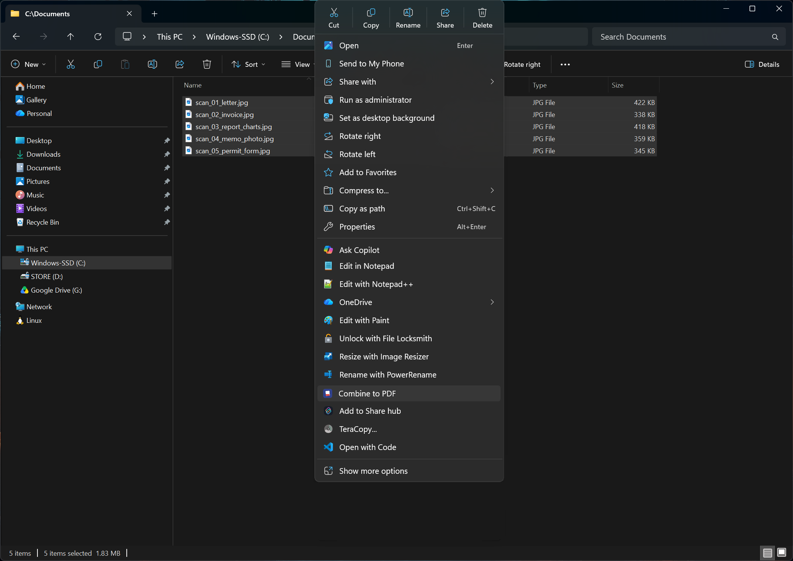
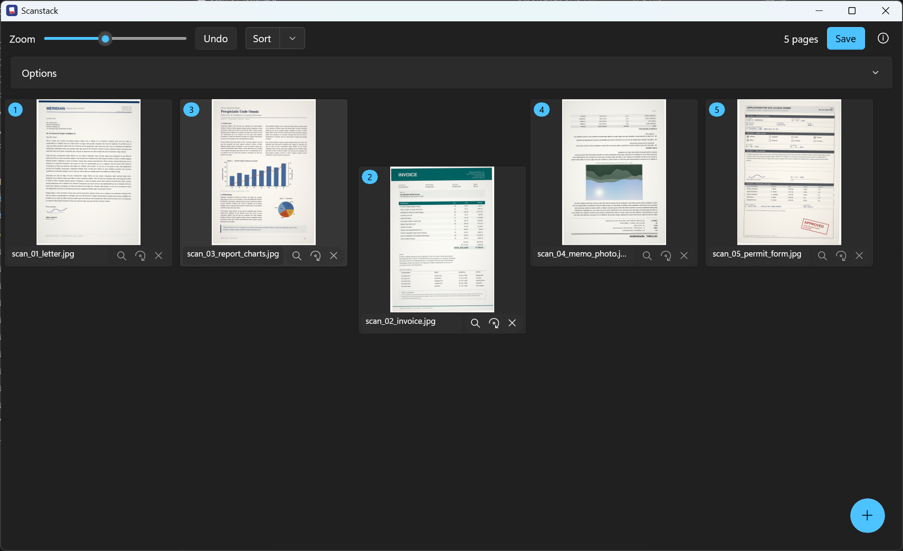
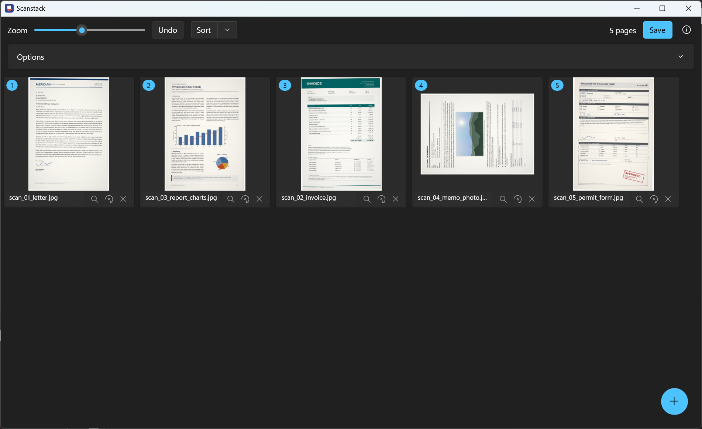
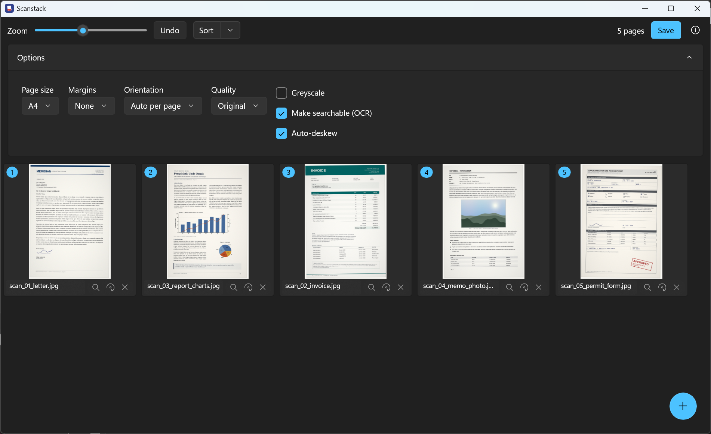

# ClickTo: PDF

A Windows utility that turns a folder of scanned images into a single PDF, in about
three clicks. Select images in File Explorer, right-click, **Combine to PDF**, drag the
pages into order, save.

> Portfolio snapshot of a shipped project — see [License](#license). The maintained
> source lives at [The-Bureau-of-Stuff/Img2PDF](https://github.com/The-Bureau-of-Stuff/Img2PDF)
> (public, MIT); this copy is a point-in-time mirror and won't track every future change.

**Published on the Microsoft Store**, v1.0.0.

## Screenshots


*Select images in File Explorer, right-click, and choose "Combine to PDF" — no need to open the app first.*


*Every page as a large, readable thumbnail. Drag to reorder, or move pages with Ctrl and the arrow keys.*


*Rotate individual pages 90° either way, without ever touching the original file.*


*Optional searchable text layer and auto-deskew for scans that came in slightly crooked.*


*Save confirmation, with quick links to open the file or show it in Explorer.*


*The result: a clean, properly ordered, searchable PDF.*

## Why

Windows' built-in "Print to PDF" locks page order to filename order, crops full-page
photos, and letterboxes landscape scans. Full PDF editors can merge images, but their
quick-merge dialogs list filenames only — no help when files are named
`IMG_0043.jpg … IMG_0051.jpg`. ClickTo: PDF does the one thing that actually matters: show
the pages, drag them into order, done.

## Features

- Right-click images in File Explorer and choose **Combine to PDF** — no need to open the app first
- Large, readable thumbnails in a reorderable grid; drag to reorder, or Ctrl+arrow keys
- Rotate individual pages 90° either way, without touching the original file
- Remove pages before saving; undo at least 20 steps deep
- Double-click a page for a full-size preview; zoom the thumbnail grid
- Pages load in natural filename order (`IMG_2` before `IMG_10`)
- Optional searchable text layer (OCR) and auto-deskew for crooked scans
- A4 or Letter output, automatic per-page orientation, adjustable margins/quality/greyscale
- JPEGs are embedded without re-encoding wherever possible — no quality loss, no bloat
- EXIF orientation honoured; images always scaled to fit, aspect ratio preserved, never cropped
- Local-only diagnostic logging and an About-dialog "Report a problem" flow — nothing is ever transmitted
- No account, no telemetry, no network calls — everything happens on-device; source images are opened read-only and never modified

## Tech stack

| Component | Stack |
|---|---|
| Shell extension | Native C++ (WRL), `IExplorerCommand` — adds the Explorer context-menu entry |
| App UI | C# / .NET 8, WinUI 3, MVVM via CommunityToolkit.Mvvm |
| Image decode | `Windows.Graphics.Imaging.BitmapDecoder` (WinRT) |
| PDF writing | [PDFsharp](https://github.com/empira/PDFsharp) 6.x, with JPEG passthrough |
| Packaging | Windows Application Packaging Project → MSIX |
| Tests | xUnit |

Three components ship in one MSIX package: a native shell-extension DLL that Explorer
loads directly (kept deliberately tiny and crash-proof), the WinUI 3 app that does all
the real work, and the packaging project that bundles them. See
[`docs/pagemerge-spec.md`](docs/pagemerge-spec.md) for the full technical spec and the
architecture rationale, and [`docs/ui-refinement-brief.md`](docs/ui-refinement-brief.md)
for the UI design pass.

## Project layout

```
src/
  Img2PDF.Core/            Imaging, layout, PDF composition, OCR — no UI dependencies
  Img2PDF.App/              WinUI 3 app: MainWindow, ViewModels, state, converters
  Img2PDF.Cli/               Console entry point used for engine validation
  Img2PDF.ShellExtension/   Native C++ IExplorerCommand implementation
  Img2PDF.Package/          MSIX packaging project
tests/
  Img2PDF.Core.Tests/       Deskew, page layout, OCR mapping
  Img2PDF.App.Tests/        Settings, natural sort, save-file naming, undo
```

Note: the codebase keeps the original `Img2PDF.*` naming throughout (repo, projects,
namespaces) even after the product itself was renamed to ClickTo: PDF for the Store —
an intentional internal-codename-vs-brand split, not drift.

## Download

**ClickTo: PDF** is free on the Microsoft Store:

**[Get it from the Microsoft Store](https://apps.microsoft.com/detail/9NF364X93V6L)**

It installs and updates through the Store like any other app — no separate download,
no certificate to trust, signed with a proper Store certificate.

## Building from source

Requires Visual Studio 2022 with the "Universal Windows Platform development" and
".NET desktop development" workloads. Open `Img2PDF.sln` and build/run the
`Img2PDF.App` project directly, or build the `Img2PDF.Package` project to produce an
installable (unsigned) MSIX package.

## License

All rights reserved — see [LICENSE](LICENSE). Source is shared here for portfolio
purposes; no reuse, modification, or redistribution rights are granted. (The maintained
original at [The-Bureau-of-Stuff/Img2PDF](https://github.com/The-Bureau-of-Stuff/Img2PDF)
is MIT-licensed.)
